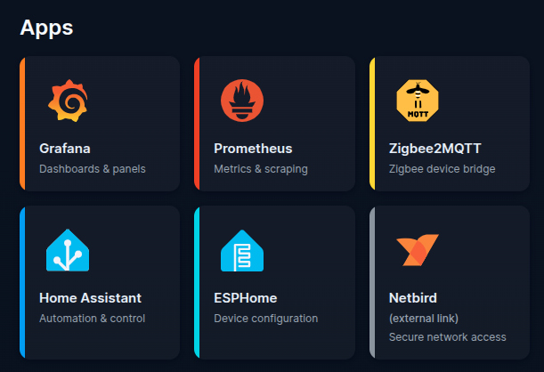

# IoT Sensor Network Monitoring

This repository contains the source code, Ansible automation, and documentation for an IoT sensor network monitoring solution developed as part of a master's thesis.

The project includes:
- A Docker-based monitoring stack for the server side
- Home Assistant, Grafana, Prometheus, Mosquitto, Zigbee2MQTT, NGINX, and supporting services
- ESPHome-based sensor configuration generation and firmware deployment
- Netbird integration for internal DNS and secure remote access
- Backup and restore playbooks for Docker volumes and bind mounts

This repository is organized into two main sections:

- [`ansible/`🔗](ansible) – server deployment, sensor preparation, and maintenance automation
- [`sensors/`🔗](sensors) – ESPHome sensor definitions, examples, helper scripts, and hardware notes

## Documentation

Documentation is provided in the `docs/` directory and covers the following topics:

- [Documentation index](docs/README.md)
- [Server documentation](docs/server.md)
- [Sensors documentation](docs/sensors.md)

