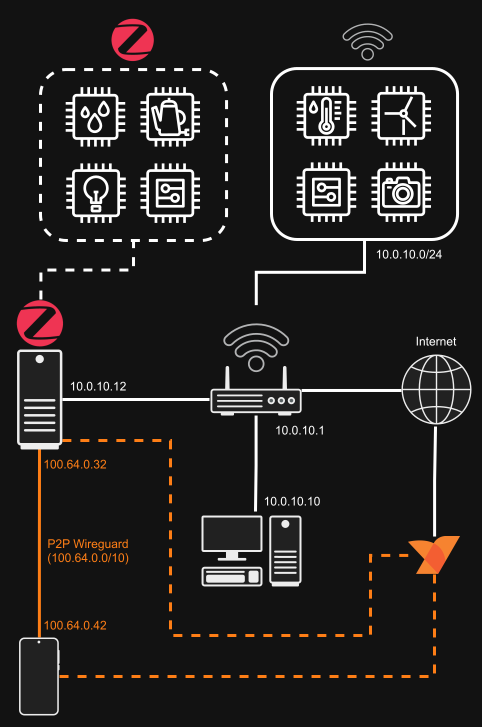

# Documentation

This folder is the main entry point for the project documentation.

## Server

All documentation related to the server deployment, Docker stack, and maintenance tasks can be found in the [`server.md`🔗](server.md) section.

## Sensors

All documentation related to the sensors, including ESPHome configuration, examples, and hardware notes can be found in the [`sensors.md`🔗](sensors.md) section.

## Ansible

More general info about the Ansible playbooks, inventory structure, and usage can be found in the [`ansible/README.md`🔗](../ansible/README.md) file.

## Network

The picture shows an example of the network topology for the project. The server is connected to the local network 
and also has a Netbird tunnel interface for secure remote access. The sensors are connected to the local network and 
communicate with the server. Zigbee sensors communicate with the server via a USB Zigbee coordinator.

