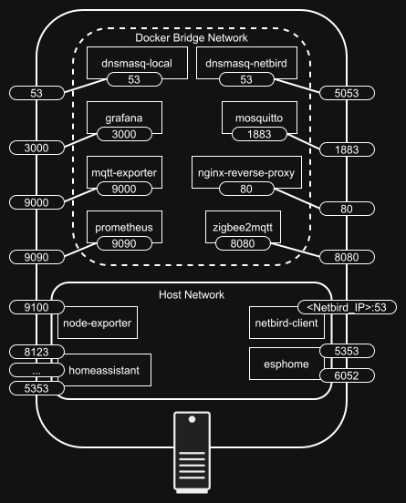

# Server Documentation

This section describes the server side of the IoT monitoring platform.

The server is deployed and maintained with Ansible. It hosts the Docker-based monitoring stack, provides DNS services for the internal network, and integrates with Netbird for secure connectivity.

## Deployed services

The main Docker Compose stack includes:

- Prometheus
- Grafana
- Mosquitto
- MQTT exporter
- Node exporter
- Zigbee2MQTT
- Home Assistant
- NGINX reverse proxy
- ESPHome dashboard
- dnsmasq for the local network
- dnsmasq for the Netbird network
- Netbird client



## Deployment overview

The main server playbook is `ansible/server_install.yaml`. It runs these steps in order:

1. `system_setup`
   - sets up passwordless sudo for the Ansible user
   - configures the hostname
   - installs mDNS support with `avahi-daemon`
   - prepares the host so `dnsmasq` can use port 53
2. `docker`
   - installs Docker Engine and the Compose plugin
3. `iot_stack`
   - creates the directory structure under `iot_base_dir`
   - copies the Docker Compose assets
   - renders the `.env` file and service configuration templates
   - creates a Netbird setup key for the server
   - starts the monitoring containers
   - configures both local and Netbird DNS services
4. `netbird_dns`
   - waits for the Netbird tunnel interface to receive an IP address
   - publishes the server as a DNS nameserver group in Netbird

## Required configuration

Before running the playbook, prepare these files in the `ansible/` directory:

- `inventory.yaml` from [`inventory.example.yaml`🔗](../ansible/inventory.example.yaml)
- `group_vars/all.yaml` from [`group_vars/all.example.yaml`🔗](../ansible/group_vars/all.example.yaml)
- `group_vars/servers.yaml` from [`group_vars/servers.example.yaml`🔗](../ansible/group_vars/servers.example.yaml)
- `vault.yaml` from [`vault.example.yaml`🔗](../ansible/vault.example.yaml)

**Note:** The `vault.yaml` file should be created with `ansible-vault` and encrypted with a secure password. It contains sensitive values that are used in the configuration templates and should not be committed to version control.

## Server prerequisites

- Debian-based Linux distribution (e.g., Debian, Armbian, Ubuntu)
- SSH access for Ansible (preferably with key-based authentication)
- Static IP address
- A user account with sudo privileges for Ansible operations
- Internet access for package installation and Docker image pulls
- A Netbird account with API key

## Testing

This deployment has been tested with the software of the following versions:
- OS: Debian 13 (trixie) and Armbian v25.11.2 (trixie-based)
- Docker version 29.2.1, build a5c7197
- Docker Compose version v5.0.2
- Containers:
  - grafana 12.3.1
  - netbird-client 0.65.0
  - dnsmasq-local 2.92
  - dnsmasq-netbird 2.92
  - zigbee2mqtt 2.8.0
  - mqtt-exporter 1.11
  - homeassistant-docker 2026.2.2
  - mosquitto 2.0.22
  - nginx-reverse-proxy 1.29.5
  - esphome 2026.2.2
  - prometheus 3.9.1
  - node-exporter 1.10.2

## Running the deployment

From the `ansible/` directory, the server can be deployed with:

```bash
ansible-playbook server_install.yaml
```

### Useful parameters

- `-K` – ask for the sudo password if not using passwordless sudo
- `-k` – ask for the SSH password if not using key-based authentication
- `--ask-vault-pass` – ask for the vault password to decrypt `vault.yaml` if not using a `.vault_password` file
- `-l <host_or_group>` – limit the playbook run to a specific host or group defined in the inventory
- `-t <tag>` – run only specific tagged tasks or roles, available tags are:
  - `setup`
  - `install`
  - `run`
  - `netbird`

### Post-deployment steps

After the playbook completes, the server should be up and running with the monitoring stack. However, Home Assistant 
will require some additional configuration through its web interface.

1. Access Home Assistant at `http://homeassistant.<your_domain_or_ip>/`
2. Complete the initial setup by creating an account and configuring basic settings
3. Add the MQTT integration and configure it to connect to the local Mosquitto broker
4. Create long-lived access tokens (Profile > Security > Create Token) for use in the Prometheus configuration
5. Save the token to Ansible vault and run the `add_ha_bearer.yaml` playbook to update Prometheus with the new token

## Backup and restore

The `ansible/` directory also contains backup playbooks for the server:

- `docker_backup.yaml` – creates a backup of Docker named volumes and bind mounts
- `docker_backup_restore.yaml` – restores the server from a previously created backup archive

The backup playbook stores archives in `ansible/backups/` by default. It includes both Docker named volumes and the configuration bind mounts stored under `iot_base_dir`.

The restore playbook selects the most recent backup archive by default, but a specific archive can be specified with the `backup_file` variable. For example:

```bash
ansible-playbook docker_backup_restore.yaml -e "backup_file=<your_backup>.tar.gz"
```
