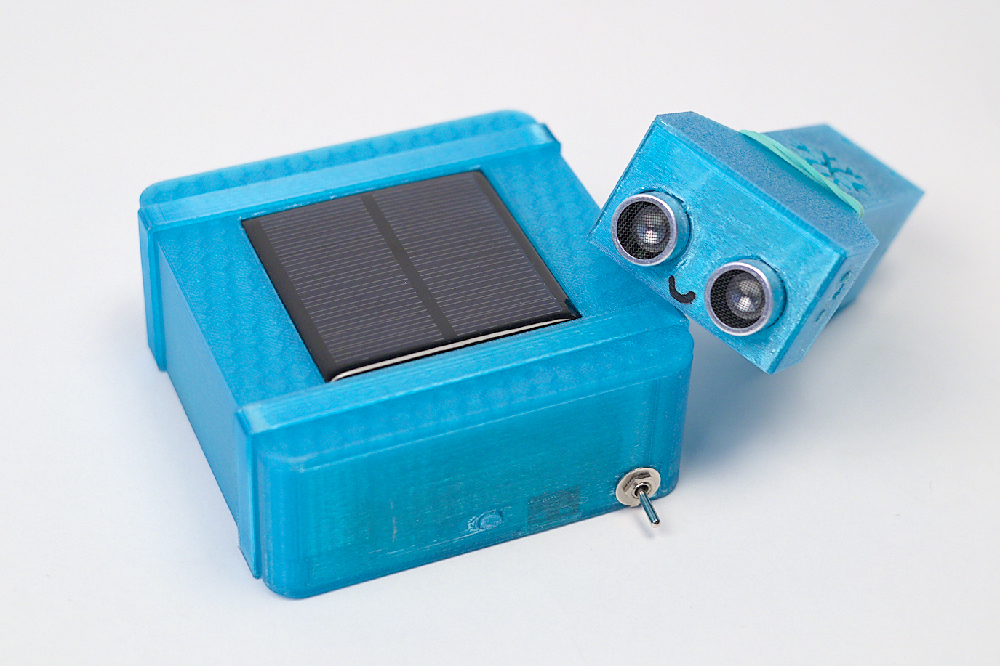
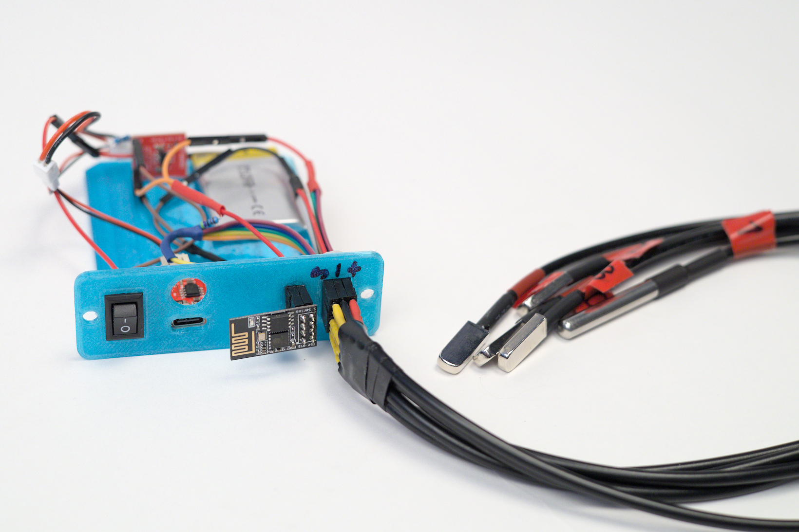
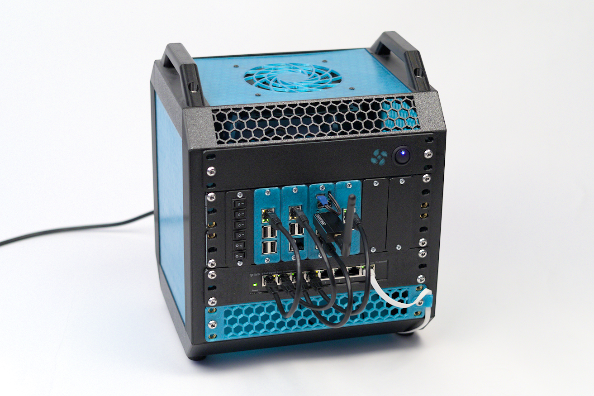

# 3D Models

This directory contains 3D models and enclosure designs used by the project. Each subfolder below contains one model or a related set of files.

## Contents

- [Banana Pi BPI-M2S](banana_pi_m2s) – tray for Lab Rax SBC holder
- [Cudy AX3000](cudy_ax3000_router) – Lab Rax tray for Cudy router
- [Fan Controller](fan_controller) – Lab Rax plate with button for a fan control
- [Lab Rax SBC holder remix](labrax_sbc_holder_remix) – Lab Rax tray for holding up to 7 single-board computers, switch tray and blank cover
- [Mean Well LRS 100-5](mean_well_lrs_100-5_power_supply) – Lab Rax tray for Mean Well power supply
- [Multi-temperature sensor](multi_temperature_sensor) – tray compatible with SBC holder
- [Rock Pi](rock_pi) – tray for Lab Rax SBC holder
- [Snow sensor](snow_sensor) – enclosure for Snow sensor prototype
- [Solar sensor](solar_sensor) – enclosure for Solar sensor prototype
- [TP-Link TL-SG108E](tp-link_tl-sg108e_switch) – Lab Rax tray for TP-Link switch

## Related projects

### Lab Rax

Lab Rax is a fully 3D printable, modular 10-inch server rack for homelabs. The test setup for this project is built using Lab Rax components, and many of the 3D models in this directory are designed to fit into the Lab Rax system.

Original [Lab Rax collection](https://makerworld.com/cs/collections/5813742-lab-rax) by mklements is available on MakerWorld.

### Other projects

The list of other projects used in this project:

- [10' - 1U - Server Rack Template](https://www.printables.com/model/697999-10-1u-server-rack-template) by Yury Komarov on Printables
- [Dupont connector bridge](https://www.printables.com/model/1644379-dupont-connector-bridge) by Rong on Printables
- [RamjetX Dupont Male Header to PC Fan Connector](https://www.printables.com/model/115806-ramjetx-dupont-male-header-to-pc-fan-connector) by RamjetX on Printables
