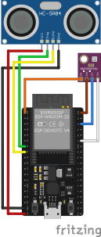
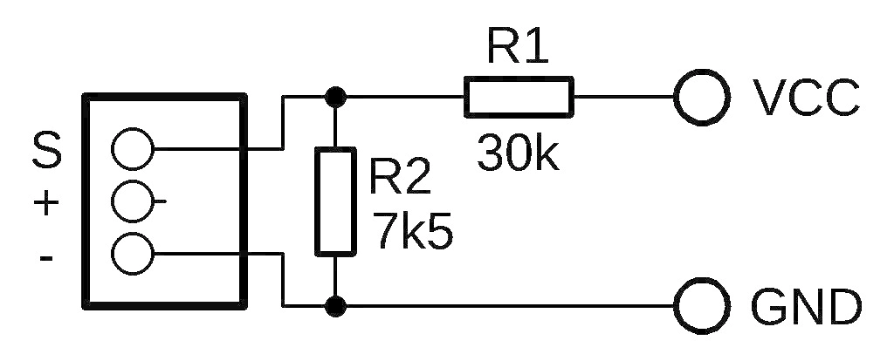

# Sensor Wiring

This directory contains wiring diagrams of the sample sensors.

## Snow sensor

### Parts

- ESP32 DevKitC
- HC-SR04 ultrasonic distance sensor
- BMP280 barometric pressure and temperature sensor

### Wiring

## Temperature and humidity sensor

### Parts

- ESP-01S (ESP8266-based)
- DHT11 temperature and humidity sensor module

### Wiring

- ESP-01S VCC (3V3) to DHT11 VCC
- ESP-01S GND to DHT11 GND
- ESP-01S GPIO0 to DHT11 data pin

## Multi-temperature sensor

### Parts

- ESP-01S (ESP8266-based)
- 5x DS18B20 waterproof temperature sensors
- 4.7kΩ pull-up resistor

### Wiring

- ESP-01S VCC (3V3) to **all** DS18B20 VCC
- ESP-01S GND to **all** DS18B20 GND
- ESP-01S GPIO0 to **all** DS18B20 data pins
- 4.7kΩ pull-up resistor between GPIO0 and VCC (3V3)

## Solar sensor

### Parts

- ESP32-C6 DevKit
- 5V solar panel
- voltage sensor module (voltage divider 30kΩ and 7.5kΩ resistors)
- voltage regulator (e.g., XC6220)
- power management board (recycled from an old solar power bank)
- battery (I used a LiPo 900mAh.)
- optional: on/off switch

### Wiring

- Battery (B+, B-) to power management board (B+, B-)
- Battery (B+, B-) also to voltage regulator input
- Solar panel (S+, S-) to power management board (S+, S-)
- Solar panel (S+, S-) also to voltage sensor input
- Voltage sensor (S) to ESP32-C6 GPIO3
- Voltage sensor (+, -) to ESP32-C6 (3V3, GND)
- Voltage regulator output (3V3, GND) to ESP32-C6 (3V3, GND)
- Optional switch between voltage regulator positive input and EN pin

### Voltage sensor circuit

## Rain sensor

### Parts

- ESP32-C6 DevKit
- rain sensor module (based on a comparator LM393)

### Wiring

- ESP32-C6 VCC (3V3) to rain sensor VCC
- ESP32-C6 GND to rain sensor GND
- ESP32-C6 GPIO3 to rain sensor digital output pin
